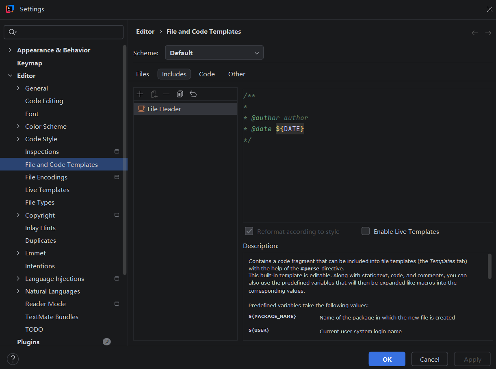

# Java注释

> Java注释分为单行注释、多行注释、文档注释。

## 单行注释

单行注释通常用于解释方法内某单行代码的作用。

```java
public void method() {
    // age用于表示年龄
    int age = 18;
}
```

## 多行注释

多行注释通常用于解释一段代码的作用。

```java
/*
        age用于表示年纪
        name用于表示姓名
 */
int age = 18;
String name = "沉默王二";
```

## 文档注释

文档注释可用在三个地方（类、字段和方法），用来解释它们是干嘛的。

```Java
/**
 * java文档注释
 */
public class Demo {
    /**
     * 姓名
     */
    private int age;

    /**
     * main方法作为程序的入口
     *
     * @param args 参数
     */
    public static void main(String[] args) {

    }
}
```

### 使用javadoc命令生成代码文档

在终端页面使用`javadoc Demo.java -encoding utf-8`这条命令可生成代码文档。

### 文档注释的注意事项

1. `javadoc`命令只能为public和protected修饰的字段、方法和类生成文档。
2. 文档注释中可以嵌入一些HTML标记
3. 文档注释中可以插入一些`@`注解。

## 注释规约

1. 类、字段、方法必须使用文档注释，不能使用单行注释和多行注释。文档注释在IDE编辑窗口中可以悬浮提示，提高编码效率。
2. 所有的抽象方法（包括接口中的方法）必须要用Javadoc注释，除了返回值、参数、异常说明外，还必须指出该方法做什么事情，实现什么功能。
3. 所有的类都必须添加创建者和创建日期。
4. 所有的美剧类型字段必须要有注释，说明每个数据项的用途。
5. 代码修改的同时，注释也要进行相应的修改。

## Intellij IDEA中设置创建者和创建日期注释

{thumbnail="true"}

```Java

/**
* 
* @author author
* @date ${DATE}
*/

```